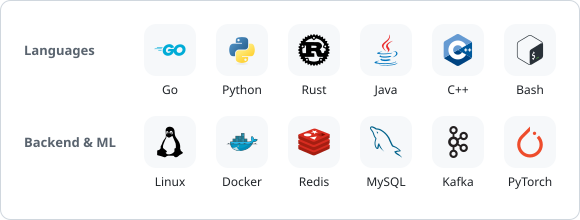
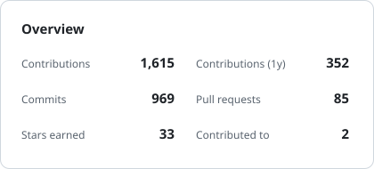
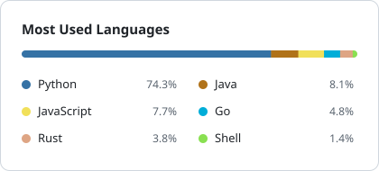

<h1>Hi, I'm Ivan 👋</h1>

<b>Backend &amp; distributed systems · LLM agents</b>

  <a href="https://zone.ivanz.cc">Blog</a> ·
  <a href="https://www.researchgate.net/profile/Yifan-Zhang-253/">ResearchGate</a>

## About me

- 🛠️ I enjoy backend and distributed systems, and like to understand how things work under the hood.
- 🤖 Lately I've been working on LLM agents and AI engineering, and contribute to [multica](https://github.com/multica-ai/multica).
- 🔬 My research background is privacy-preserving federated learning and applied cryptography.
- 🎣 Away from the keyboard, I can spend a whole day fishing by the river.

## Tech stack

  <picture>
    <source media="(prefers-color-scheme: dark)" srcset="./assets/tech-stack-dark.svg">
    
  </picture>

## GitHub stats

  <picture>
    <source media="(prefers-color-scheme: dark)" srcset="./assets/stats-overview-dark.svg">
    
  </picture>
  <picture>
    <source media="(prefers-color-scheme: dark)" srcset="./assets/stats-languages-dark.svg">
    
  </picture>

## Education

<table>
  <tr>
    <td></td>
    <td><b>Xidian University</b> · 2022 – 2025 Master's in Electronic Information (Network and Information Security)</td>
  </tr>
  <tr>
    <td></td>
    <td><b>Nanchang University</b> · 2018 – 2022 Bachelor's in Software Engineering</td>
  </tr>
</table>
